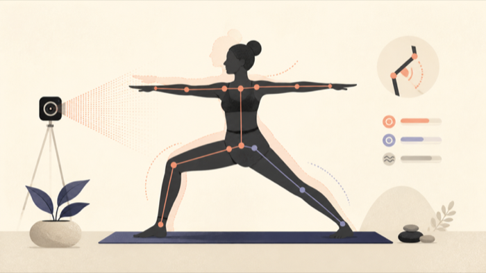

# Yoga Pose Match

A browser-based yoga pose game that uses live camera landmarks to coach users through a sequence of poses.

Built for Rose Hackathon 2026, Yoga Pose Match turns pose estimation into a friendly movement challenge: the user matches a target pose, receives live feedback, holds the position, and earns points and streaks.

> **Status:** functional hackathon prototype. The FastAPI server and browser experience are implemented, but camera behavior and pose accuracy still require cross-device testing.

## Features

- live webcam preview with a mirrored landmark overlay
- MediaPipe pose detection running in the browser
- angle-based matching with per-pose targets and tolerances
- friendly distance, alignment, countdown, and hold feedback
- joint-specific coaching that names the area furthest from its target angle
- score and streak progression
- multi-person detection that selects the clearest visible subject
- generated pose definitions from training CSV statistics
- local FastAPI endpoint for pose data and static web delivery

## Demo

A current gameplay screenshot or short recording is still needed. Because the app uses a camera, the README intentionally does not include personal test footage.



*Illustrative project visual—not a runtime screenshot.*

## Technology

- JavaScript, Canvas, and MediaPipe Tasks Vision
- FastAPI and Uvicorn
- Python and pandas for converting pose datasets to JSON
- CSV-derived pose angle targets

## Architecture

```text
pose CSV samples --(converter)--> poses.json
                                     |
browser camera --> MediaPipe landmarks --> joint angles
                                     |
                           target/tolerance scoring
                                     |
                      joint-specific coaching, score, and streak
```

The server in `backend/main.py` serves `web/index.html` and exposes `/api/poses`. Pose inference runs client-side; camera frames are not uploaded to the Python server.

## Setup

```bash
python -m venv .venv
```

Windows:

```powershell
.\.venv\Scripts\Activate.ps1
python -m pip install -r backend\requirements.txt
```

macOS/Linux:

```bash
source .venv/bin/activate
python -m pip install -r backend/requirements.txt
```

## Run

```bash
uvicorn backend.main:app --reload
```

Open [http://localhost:8000](http://localhost:8000), select **Start**, and approve camera access. A secure context is required for camera access when the project is hosted remotely.

## Rebuild pose data

The converter summarizes labeled angle samples into target values and statistical tolerances:

```bash
python poses/csv_to_pose_json.py --csv poses/DownwardDog_Combined.csv --out web/poses.json
```

Review generated IDs and targets before replacing the application data. The current dataset and converter still need stronger schema validation.

## Privacy and accessibility

- camera processing happens in the browser
- the FastAPI backend serves pose definitions and does not receive video frames
- camera permission is requested only after the user selects Start
- visible status text accompanies sound cues

The interface still needs keyboard, reduced-motion, screen-reader, and mobile camera testing.

## Validation

Deterministic tests cover pose-label parsing, grouped target generation, tolerance bounds, and invalid input schemas:

```bash
python -m unittest discover -s tests -v
```

GitHub Actions runs the tests and compiles the Python modules on every push and pull request. Camera behavior still requires a real-device check before presenting the project as production-ready:

- API startup and `/api/poses`
- camera permission denial and recovery
- no-person and multiple-person states
- pose progression across supported browsers
- mobile landscape and portrait layouts

## Known limitations

- MediaPipe model assets are loaded from external CDNs
- pose scoring uses selected joint angles rather than a full biomechanical model
- targets derived from small or inconsistent datasets may score poorly
- the current generated pose data includes fields that the browser scorer does not use
- camera quality, lighting, clothing, and framing affect results
- this is a game/learning prototype, not medical or fitness advice

## Roadmap

- add a calibration mode before scoring starts
- add tests around scoring tolerance and coaching direction
- add pause, skip, and camera-retry controls
- test reduced-motion and keyboard-only operation
- capture a privacy-safe demo

## License and authorship

Created by [SimpleCaci](https://github.com/SimpleCaci) for Rose Hackathon 2026 and released under the [MIT License](LICENSE).
